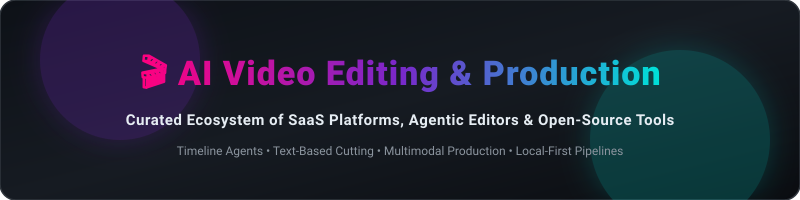

# 🎬 Awesome AI Video Editing & Production

**A definitive directory of AI-powered video editing tools, generative production suites, transcript-based editors, and agent-driven open-source workflows.**

*Explore the top SaaS platforms, local-first NLEs, and developer toolkits modernizing digital video creation.*

📅 **Last updated: November 2026**

---

## 📑 Table of Contents

- [🌐 Sector Overview & Market Dynamics](#-sector-overview--market-dynamics)
- [☁️ SaaS & Hosted Platforms](#️-saashosted-platforms)
- [💻 Open-Source GitHub Projects](#-open-source-github-projects)
- [🛠️ Recommended Architecture for Custom AI Pipelines](#️-recommended-architecture-for-custom-ai-pipelines)
- [🤝 How to Contribute](#-how-to-contribute)
- [💖 Support](#-support)
- [⭐ Star History](#-star-history)
- [⚠️ Disclaimer](#️-disclaimer)

---

## 🌐 Sector Overview & Market Dynamics

The global AI video editing and creation market is estimated at roughly **$3.75B to $4.4B**, expanding at a compound annual growth rate (CAGR) exceeding **18–20%** as automated workflows transition from experimental tech to standard production utilities. 

The sector remains **moderately to highly fragmented** rather than a single winner-take-all monopoly:
- **Specialized Point Solutions**: Independent leaders dominate dedicated niches—text-based cutting (*Descript*), generative diffusion and inpainting (*Runway*), remote high-fidelity capture (*Riverside*), and programmatic video generation (*Remotion*).
- **Enterprise Creative Suites**: Incumbents (*Adobe Creative Cloud*, *Microsoft 365*) are embedding native AI features to defend massive legacy footprints.
- **Local-First & Agentic Stack**: Privacy-first, local-run workflows powered by open-source transcription (*Whisper*), programmatic rendering (*FFmpeg*, *MoviePy*), and autonomous cutting agents (*Timeline Studio*, *ClipTalk*) provide robust alternatives for creators and developers seeking total data ownership.

---

## ☁️ SaaS & Hosted Platforms

A comparison of leading hosted AI video suites, sorted in descending order by company scale:

| Product | Company Scale (Valuation / Revenue) | Description | Starting Tier Pricing | Free Tier Limits |
| :--- | :--- | :--- | :--- | :--- |
| **[Clipchamp](https://clipchamp.com/)** | ~$3.1T Market Cap (Microsoft) | Microsoft’s accessible video editor (web and Windows) with templates, auto captions, and straightforward export options. | $11.99/mo (or bundled in Microsoft 365) | Free forever: Unlimited exports up to 1080p, no watermarks, basic stock assets (4K & cloud backup require Premium) |
| **[Adobe Premiere Web](https://www.adobe.com/products/premiere.html)** | ~$90B Market Cap / ~$21B+ Rev (Adobe) | Browser-oriented Premiere experience connected to Adobe’s Creative Cloud ecosystem and Firefly AI features. | $22.99/mo (Premiere Pro annual plan) | 7-day free trial (full desktop/web companion access; Adobe Express companion free tier offers 25 monthly AI credits & 5GB storage) |
| **[Runway Video Editor](https://runwayml.com/)** | $5.3B Valuation / ~$200M ARR | AI-native creative suite combining generative diffusion, inpainting, motion tools, and timeline workflows. | $15/mo ($12/mo billed annually) | Free forever: 125 one-time lifetime generation credits (no recurring refill), 720p exports with watermark, 5GB storage |
| **[Descript](https://www.descript.com/)** | ~$550M Valuation / ~$55M ARR | Transcript-based video and podcast editor: edit media by editing text, with filler removal, overdub, and collaboration features. | $16/mo ($24/mo billed monthly) | Free forever: 1 hour (60 min) transcription per month, 100 one-time AI credits, 720p export cap, 5GB storage |
| **[Riverside.fm](https://riverside.fm/)** | ~$500M+ Valuation / $100M+ ARR | Studio-quality remote recording plus AI-assisted editing, magic clips, and social repurposing for creators. | $24/mo ($35/mo billed monthly) | 14-day free trial with full access to Pro/Grow recording & AI editing features (no permanent free tier) |
| **[InVideo](https://invideo.io/)** | ~$200M+ Valuation / $70M+ ARR | Template-driven AI video creation and editing aimed at marketing, explainers, and high-volume social content. | $10/seat/mo ($20/mo billed monthly) | Free forever: Generates script/video previews with watermark, 720p exports, 10 min/week AI generation cap |
| **[VEED.IO](https://www.veed.io/)** | ~$150M–$250M Valuation / ~$50M ARR | Online editor focused on auto subtitles, AI translations, branding, and social-ready exports. | $12/mo ($25/mo billed monthly) | Free forever: 720p export cap, mandatory watermark, 10 min export length limit, 50 AI credits/mo, 2GB storage |
| **[Kapwing](https://www.kapwing.com/)** | ~$50M–$100M Valuation / ~$10M ARR | Browser-based collaborative editor for fast cuts, smart captions, repurposing, and multi-user workspace editing. | $16/seat/mo ($24/mo billed monthly) | Free forever: 720p export cap, watermark on exports, 4 min max per video, 30 min total export time/mo, 10 lifetime AI credits |
| **[WeVideo](https://www.wevideo.com/)** | Private Equity Owned / ~$4M+ ARR | Cloud video platform for education and enterprise teams with collaborative editing and classroom tools. | $20/mo ($28/mo billed monthly) | 7-day free trial (Creator/Instructor features; legacy free plan limited to 5 min/mo publish time, 1GB storage, watermark) |
| **[FlexClip](https://www.flexclip.com/)** | Bootstrapped / Private (PearlMountain) | Cloud video maker with stock assets, animated templates, and AI-assisted creation for marketing clips. | $11.99/mo ($19.99/mo billed monthly) | Free forever: 720p export cap, FlexClip intro watermark branding, max 10 min video length, 12 saved projects limit |

---

## 💻 Open-Source GitHub Projects

Explore open-source video editing suites, speech-to-text models, agentic workflows, and rendering frameworks. Sorted in **descending order by GitHub star count**:

- **[openai/whisper](https://github.com/openai/whisper)**   
  General-purpose speech recognition model widely used for automated transcription, subtitle generation, and text-based cut points.

- **[remotion-dev/remotion](https://github.com/remotion-dev/remotion)**   
  Create video programmatically in React; build dynamic data-driven videos, automated captions, and cloud video rendering pipelines.

- **[FFmpeg/FFmpeg](https://github.com/FFmpeg/FFmpeg)**   
  The industry-standard cross-platform solution to record, convert, filter, and stream audio and video.

- **[SYSTRAN/faster-whisper](https://github.com/SYSTRAN/faster-whisper)**   
  Reimplementation of Whisper using CTranslate2, delivering up to 4x faster transcription speed with significantly reduced memory footprint.

- **[m-bain/whisperX](https://github.com/m-bain/whisperX)**   
  Whisper-based speech recognition featuring phoneme-level word timestamps, voice activity detection (VAD), and speaker diarization.

- **[chidiwilliams/buzz](https://github.com/chidiwilliams/buzz)**   
  Desktop application powered by Whisper that transcribes and translates offline audio into subtitles (SRT, VTT, TXT) seamlessly.

- **[jianchang512/pyvideotrans](https://github.com/jianchang512/pyvideotrans)**   
  Video translation and dubbing tool that transcribes speech, translates subtitles into various languages, and generates synchronized audio dubs.

- **[mltframework/shotcut](https://github.com/mltframework/shotcut)**   
  Cross-platform, open-source non-linear video editor (NLE) supporting hundreds of audio and video formats, native timeline editing, and 4K support.

- **[Zulko/moviepy](https://github.com/Zulko/moviepy)**   
  Python module for programmatic script-driven video editing: cutting, concatenations, title insertions, compositing, and custom effects.

- **[OpenShot/openshot-qt](https://github.com/OpenShot/openshot-qt)**   
  Award-winning open-source video editor for Linux, Mac, and Windows with a user-friendly curve, curve-based animations, and multi-track layers.

- **[KDE/kdenlive](https://github.com/KDE/kdenlive)**   
  Powerful non-linear video editing suite with multi-track editing, color grading, keyframe effects, and automated subtitle generation tools.

- **[WyattBlue/auto-editor](https://github.com/WyattBlue/auto-editor)**   
  Command-line application for automatically analyzing and cutting out dead space, pauses, and silences from video and audio files.

- **[Breakthrough/PySceneDetect](https://github.com/Breakthrough/PySceneDetect)**   
  Open-source OpenCV-based video scene analysis tool that detects shot transitions and exports split points automatically.

- **[speaches-ai/speaches](https://github.com/speaches-ai/speaches)**   
  OpenAI-compatible speech-to-text (STT) and text-to-speech (TTS) inference server optimized for local video processing pipelines.

- **[trykimu/videoeditor](https://github.com/trykimu/videoeditor)**   
  Modern open-source web video editor positioned as a CapCut and Canva alternative featuring multi-track editing and AI assistance.

- **[MartinDelophy/ai-video-editor](https://github.com/MartinDelophy/ai-video-editor)**   
  Timeline Studio: Local-first browser video editor where human creators and autonomous AI agents collaborate on the same interactive timeline.

- **[GML-MMGroup/ClipTalk](https://github.com/GML-MMGroup/ClipTalk)**   
  Conversational AI agent that edits video based on natural language instructions—plans and cuts highlight clips directly from long-form video.

- **[kwakseongjae/dawn-cut](https://github.com/kwakseongjae/dawn-cut)**   
  Fully local AI video editor featuring text-based cutting, automatic subtitles, silence removal, and custom style presets without cloud dependence.

- **[art-daddy/artdaddy](https://github.com/art-daddy/artdaddy)**   
  Local-first open-source video editor (GPL) designed for private, agentic editing through Model Context Protocol (MCP) integrations.

- **[gAlexander77/openframe](https://github.com/gAlexander77/openframe)**   
  Open desktop-first NLE (Tauri + React) engineered so AI agents can execute CapCut-style workflows with local AI toolchains.

---

## 🛠️ Recommended Architecture for Custom AI Pipelines

To build an autonomous, privacy-conscious video production system:
1. **Silence & Scene Detection**: Use **[auto-editor](https://github.com/WyattBlue/auto-editor)** or **[PySceneDetect](https://github.com/Breakthrough/PySceneDetect)** to trim dead air and segment shots.
2. **Speech Transcription & Alignment**: Process audio locally with **[faster-whisper](https://github.com/SYSTRAN/faster-whisper)** or **[whisperX](https://github.com/m-bain/whisperX)** for word-accurate alignment and speaker diarization.
3. **Interactive & Agent Timeline**: Load footage into **[ai-video-editor](https://github.com/MartinDelophy/ai-video-editor)** or **[OpenFrame](https://github.com/gAlexander77/openframe)** to let AI agents execute conversational cuts via **[ClipTalk](https://github.com/GML-MMGroup/ClipTalk)**.
4. **Programmatic Compositing & Export**: Automate overlay graphics, kinetic captions, and multi-track rendering via **[Remotion](https://github.com/remotion-dev/remotion)**, **[MoviePy](https://github.com/Zulko/moviepy)**, and hardware-accelerated **[FFmpeg](https://github.com/FFmpeg/FFmpeg)**.

---

## 🤝 How to Contribute

Contributions are welcome! To suggest additions or updates:
1. 🍴 **Fork** the repository.
2. 📝 **Add or update** your project or platform in `README.md` keeping the existing tabular / star-badge structure.
3. 🔍 **Verify details**: Include official links, accurate pricing, free tier limits, and factual descriptions.
4. 🚀 **Submit a Pull Request** with a brief summary of the changes.

---

## 💖 Support

Thank you for exploring and using this curated directory! If you found this repository helpful:
- ⭐ **Star** this repository to help others discover it!
- 🍴 **Fork** and share it with your network, team, or community.
- ☕ **Sponsor**: If you'd like to support ongoing curation and maintenance, consider buying a coffee via the [GitHub Sponsor Dashboard](https://github.com/sponsors/ishandutta2007).

---

## ⭐ Star History

---

## ⚠️ Disclaimer

- This repository is a community-curated list intended for informational, educational, and developer reference purposes. It does not constitute formal endorsement.
- Generative AI and automated video manipulation may process biometric data, likenesses, and copyrighted materials. Always ensure compliance with respective software licenses, acceptable use policies, and privacy regulations.

---

  <b>Built for creators, video engineers, and open-source advocates. 🎥✨</b>

